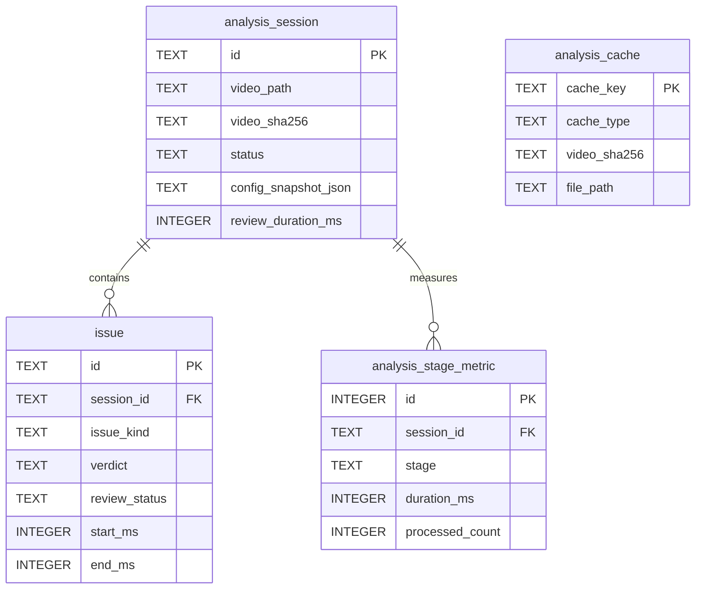

# 배리어프리 영상 AI 점검 도구 — DB 설계 초안 v0.1

> **목적:** 공모전 MVP 구현에 필요한 로컬 데이터 저장 구조 정의  
> **참고 문서:** [`implementation-plan.md`](implementation-plan.md), [`ui-spec.md`](ui-spec.md), [`screen-overview.md`](screen-overview.md)  
> **상태:** 개발 전 검토용 Draft / **DB 엔진:** SQLite (제안)  
> **범위:** Windows · PyQt6 · 로컬 분석 · 영상 1건씩 처리 · 최대 20분

## 1. 결론

**SQLite를 단일 메타데이터·검수 상태 저장소로 사용하고, 큰 STT/OCR 원시 데이터는 파일 캐시로 분리한다.** 최초 구현은 핵심 4개 테이블이면 충분하다.

| 테이블 | 용도 | 구현 시점 |
|---|---|---|
| `analysis_session` | 분석 대상 영상, 사용 설정, 실행 상태, 분석·검수 시간 | MVP 필수 |
| `issue` | AI 탐지 결과 + 사람의 검수 상태 | MVP 필수 |
| `analysis_stage_metric` | 단계별 처리 시간·처리량·캐시 사용 기록 | MVP에서 최소 수집 |
| `analysis_cache` | STT/OCR 파일 캐시의 식별 정보와 경로 | 캐시 도입 시 |

- 영상 파일 자체, 오디오, 프레임, 모델 가중치는 **DB에 BLOB으로 넣지 않는다.** 로컬 파일 경로 또는 캐시를 참조한다.
- 초기 구현 계획은 **세션 JSON + 원시 결과 캐시**를 전제로 했다. 현재 저장 동작은 코드와 테스트를 기준으로 확인한다.
- 결과 CSV는 데이터베이스 테이블이 아니라 **필요할 때 DB에서 생성하는 산출물**이다.
- 사용자 계정, 서버, 공동 작업, LLM 토큰 과금은 현 범위에서 구현하지 않는다.

## 2. 첨부 문서 간 차이와 적용 기준

| 항목 | 구현 계획 | 화면 문서 | DB 설계 권고 |
|---|---|---|---|
| AI 자동 판정 | `오류 / 검수 필요 / 판단 불가` | 주로 '검토 필요'로 표현 | `verdict`로 별도 저장. **검수 상태와 혼합 금지** |
| 사람 검수 | `확정 / 기각 / 보류` | `미검토 / 확정 / 기각` | **미검토를 초기값으로 두고 보류까지 표현 가능**하게 설계. UI에서 보류 노출 여부 확정 필요 |
| Whisper 모델 | 기본 모델 1개, 수동 변경, 사양별 자동 추천 P2 | PC 사양별 추천 모델 표시 | 최신 Plan 우선. 세션에 **실제 실행 모델·장치·설정**을 기록 |
| 자막 파일 없음 | 자막 후보 영역 추정 → **편집자 확인** → OCR SRT | 기본 하단 25% OCR | 편집자가 확정한 영역·선택 결과를 세션에 저장 |
| 세션 저장 | JSON 계획 | 로컬 저장·CSV | SQLite로 대체하는 **설계 변경 제안**. 원시 STT/OCR 캐시는 파일로 유지 |

**확정이 필요한 정책:** 화면 기획 당시의 '검수 3단계'를 유지할지, 최신 Plan에 추가된 '보류'를 UI에서도 제공할지. 스키마는 두 안을 모두 수용하도록 하되, **보류 기능을 자동으로 MVP 필수 기능으로 승격하지 않는다.**

## 3. 데이터 저장 범위

### 3.1 SQLite에 저장

- **영상·분석 세션:** 영상 경로·파일명·해시·길이, 사용 자막의 출처, 분석 상태, 시작·종료 시각
- **분석 설정 스냅샷:** STT 모델, OCR 엔진, CPU/CUDA 실행 장치, 임계값 및 자막 영역(편집자 확인 결과 포함)
- **탐지 문제:** M1/M2/M2-2 분류, 시작·종료 시점, AI 자동 판정, 심각도, 판단 근거, 비교 텍스트
- **사람 검수:** 각 문제의 미검토/확정/기각/보류 상태, 마지막 변경 시각
- **측정 정보:** STT/OCR/비교 단계 처리 시간, 처리량, 캐시 적중 여부, 누적 검수 시간
- **캐시 메타데이터:** 캐시 키, 사용 엔진·모델·입력 해시, 상대 파일 경로

### 3.2 DB 밖에 저장

| 데이터 | 권장 위치 | 이유 |
|---|---|---|
| 원본 영상·입력 자막 | 기존 사용자 파일 위치 | 영상 파일 복제 및 저장 공간 낭비 방지 |
| STT 원시 세그먼트 | `cache/stt/*.json` | 재분석 시 재사용, 대량의 원시 결과를 DB와 분리 |
| OCR 원시 프레임·문자 결과 | `cache/ocr/*.json` | 프레임 단위 결과는 크고 잦은 재가공 대상 |
| OCR 생성 SRT | `artifacts/subtitles/*.srt` | 파일 산출물로 관리 |
| 임시 추출 오디오·프레임 | `temp/` | 종료 후 정리 가능한 임시 산출물 |
| 모델 가중치 | 모델 캐시/사용자 지정 경로 | 대용량, 모델 로더가 직접 접근 |
| 내보낸 CSV | 사용자가 지정한 경로 | 외부 전달용 산출물 |

> **권고:** DB에는 원본 파일을 복제하지 않는다. 단, 사용자가 파일을 이동하거나 삭제하면 이전 세션의 영상 재생이 실패할 수 있다. 세션 메타데이터는 계속 조회 가능하게 하고, 추후 세션 열기 기능에서 파일 재연결을 검토한다.

## 4. 논리 ERD



- `analysis_session` : `issue` = **1:N**
- `analysis_session` : `analysis_stage_metric` = **1:N**
- `analysis_cache`는 특정 세션 소유가 아니다. **동일 영상·동일 엔진 설정으로 재분석하는 여러 세션에서 재사용**할 수 있으므로 의도적으로 직접 FK를 두지 않는다.
- `video`, `model`, `user`, `project` 테이블은 **지금 만들지 않는다.** 영상 라이브러리·계정·다중 사용자 요구가 확인된 다음 분리해도 된다.

## 5. 테이블 정의

### 5.1 `analysis_session` — 분석 실행 이력

| 컬럼 | 타입 | 필수 | 설명 |
|---|---|---|---|
| `id` | TEXT (UUID) | Y, PK | 실행 단위 고유 ID. 같은 영상도 재분석 시 새 ID |
| `video_path` | TEXT | Y | 원본 영상 절대 경로 |
| `video_name` | TEXT | Y | 표시용 파일명 |
| `video_sha256` | TEXT | Y | 파일 내용 해시, 캐시 식별에 사용 |
| `video_duration_ms` | INTEGER | Y | 영상 길이(밀리초) |
| `subtitle_source` | TEXT | Y | `FILE / OCR / NONE / UNKNOWN` |
| `subtitle_path` | TEXT | N | 업로드된 자막 경로 |
| `generated_srt_path` | TEXT | N | OCR 생성 SRT 상대 경로 |
| `subtitle_region_json` | TEXT | N | 확인된 OCR 자막 영역(좌표/비율 등), 확인 결과 |
| `status` | TEXT | Y | `PREPARING / ANALYZING / COMPLETED / FAILED / CANCELLED` |
| `stt_model_name` | TEXT | N | 사용한 Whisper 모델 이름 |
| `ocr_engine_name` | TEXT | N | 사용한 OCR 엔진 이름 |
| `compute_device` | TEXT | N | `CPU / CUDA` 등 실제 장치 |
| `config_snapshot_json` | TEXT | Y | 분석 당시 임계값·모델 경로/버전 등 재현용 설정 |
| `review_duration_ms` | INTEGER | Y | 누적 실제 검수 시간, 기본 0 |
| `error_code` | TEXT | N | 실패·취소 사유 식별 값 |
| `created_at` | TEXT | Y | 세션 생성 시각(UTC) |
| `started_at` | TEXT | N | 분석 시작 시각 |
| `finished_at` | TEXT | N | 분석 종료 시각 |

**정책**
- 영상 1건에 대해 새 분석을 하면 **새 세션**을 만든다. 이전 세션의 검수 결과를 덮어쓰지 않는다.
- 설정이 바뀌어 결과를 다시 산출할 때도 원본 `issue`는 보존하고 새 세션을 생성한다. STT/OCR 원시 캐시는 재사용 가능하다.
- 설정은 변경될 수 있으므로 세션에는 **실행 당시 스냅샷**을 저장한다. 앱의 현재 설정과 분리한다.
- `subtitle_region_json`은 **편집자 자막 영역 확인 과정**을 재현하기 위한 값이다. 예: `{"normalized_rect":[0,0.75,1,0.25],"decision":"CONFIRMED"}` (형식은 구현 전에 확정).
- `review_duration_ms`는 영상 분석 시간과 별개다. 검수 화면이 활성화된 동안의 시간만 누적하도록 정의하고, 백그라운드·자리 비움 처리 기준은 실증 전에 확정한다.

### 5.2 `issue` — AI 지적 + 사용자 검수

| 컬럼 | 타입 | 필수 | 설명 |
|---|---|---|---|
| `id` | TEXT (UUID) | Y, PK | 지적 고유 ID |
| `session_id` | TEXT | Y, FK | 소속 분석 세션 |
| `source` | TEXT | Y | `M1 / M2 / M2_SCREEN_DEPENDENT` |
| `issue_kind` | TEXT | Y | `VALUE_MISMATCH`, `VALUE_MISSING`, `SUBTITLE_MISSING`, `EXPRESSION_DIFFERENCE`, `SCREEN_INFORMATION`, `SCREEN_DEPENDENT` 등 |
| `verdict` | TEXT | Y | **AI 자동 판정**: `ERROR / REVIEW_REQUIRED / UNDETERMINED` |
| `review_status` | TEXT | Y | **사람의 처리 상태**: `UNREVIEWED / CONFIRMED / DISMISSED / ON_HOLD` |
| `severity` | TEXT | N | 높음/보통/낮음, 구체 기준 추후 확정 |
| `confidence` | REAL | N | 모델/판정 참고 신뢰도. **오류 확률로 해석 금지** |
| `start_ms` | INTEGER | Y | 지적 시작 시점(영상 기준 ms) |
| `end_ms` | INTEGER | Y | 지적 종료 시점(영상 기준 ms) |
| `reason` | TEXT | Y | 화면에 표시할 탐지 사유 |
| `speech_text` | TEXT | N | 음성 인식 내용(해당 구간) |
| `comparison_text` | TEXT | N | 비교한 자막 또는 화면 문자 |
| `evidence_json` | TEXT | N | 수치 비교·출처 좌표·다른 시점 언급 차이 등 추가 근거 |
| `created_at` | TEXT | Y | 문제 생성 시각 |
| `updated_at` | TEXT | Y | 마지막 검수 변경 시각 등 |

**중요 구분**

| AI `verdict` | 사람이 결정한 `review_status` | 의미 |
|---|---|---|
| `ERROR` | `UNREVIEWED` | AI가 오류라고 판단, 사람이 아직 확인하지 않음 |
| `ERROR` | `DISMISSED` | AI는 오류라고 봤지만 사람이 기각함 |
| `REVIEW_REQUIRED` | `CONFIRMED` | AI는 검수 필요로 분류, 사람이 실제 문제로 확정함 |
| `UNDETERMINED` | `ON_HOLD` | 자동 판단 근거가 부족하여 사람이 판단을 보류함 |

- AI 판정과 인간 판정은 다른 축이다. **검수 버튼을 눌러도 `verdict`를 수정하지 않는다.**
- 새 문제의 `review_status`는 **`UNREVIEWED`**이다. `ON_HOLD`는 최신 Plan과의 호환을 위해 수용하되 실제 UI 노출은 별도 결정한다.
- OCR로 생성한 자막을 사용하는 M1 문제는 최신 Plan대로 `REVIEW_REQUIRED`로만 생성한다.
- STT/OCR 판단 불가 결과는 `UNDETERMINED`로 보존한다.
- 영상 전체의 자막 부재 같은 **세션 단위 안내**는 무수한 `issue` 행으로 복제하지 않는다. 필요한 경우 세션의 `subtitle_source=NONE`을 이용해 안내를 표시한다.

### 5.3 `analysis_stage_metric` — 성능 및 검수 실증 자료

| 컬럼 | 타입 | 필수 | 설명 |
|---|---|---|---|
| `id` | INTEGER | Y, PK | 자동 증가 키 |
| `session_id` | TEXT | Y, FK | 측정 대상 세션 |
| `stage` | TEXT | Y | `MEDIA_PREPARE / STT / OCR / SUBTITLE_CHECK / SCREEN_CHECK / RESULT_SAVE` 등 |
| `attempt_no` | INTEGER | Y | 단계 재시도 회차, 기본 1 |
| `duration_ms` | INTEGER | Y | 단계 소요 시간(밀리초) |
| `processed_count` | INTEGER | N | 음성 세그먼트 수, OCR 프레임 수 등 |
| `processed_unit` | TEXT | N | `SEGMENT / FRAME / ISSUE` 등 단위 |
| `cache_hit` | INTEGER | Y | 0 또는 1 |
| `created_at` | TEXT | Y | 기록 시각 |

- 화면 통계는 **지금 만들지 않고 데이터만 기록**한다.
- 실증에 중요한 **모델별·단계별 처리 시간, OCR 처리량, 캐시 사용 여부**를 수집한다.
- `duration_ms`는 실행 과정에서 실제 측정한 값이며, 사용자에게 보여주는 예상 분석 시간이 아니다.
- 사용자 검수 소요 시간은 `analysis_session.review_duration_ms`로 별도 관리한다.
- 추후 외부 LLM 연동 시에만 `api_usage` 같은 별도 테이블을 추가한다. **현재 토큰·비용 컬럼은 만들지 않는다.**

### 5.4 `analysis_cache` — 원시 결과 캐시 인덱스

| 컬럼 | 타입 | 필수 | 설명 |
|---|---|---|---|
| `cache_key` | TEXT | Y, PK | 영상 해시 + 단계 + 엔진/모델/설정 버전으로 만든 고유 키 |
| `cache_type` | TEXT | Y | `STT / OCR` |
| `video_sha256` | TEXT | Y | 원본 영상 내용 해시 |
| `engine_name` | TEXT | Y | 엔진 식별자 |
| `model_name` | TEXT | N | 사용 모델 이름 |
| `config_hash` | TEXT | Y | 결과에 영향을 주는 설정들의 해시 |
| `file_path` | TEXT | Y | 캐시 루트 기준 상대 경로 |
| `created_at` | TEXT | Y | 생성 시각 |
| `last_used_at` | TEXT | N | 마지막 사용 시각 |

- **캐시 키를 영상 해시만으로 만들지 않는다.** STT 모델, OCR 엔진, 샘플링 비율·영역·버전이 바뀌면 원시 결과도 달라질 수 있다.
- 실제 엔진·모델 버전은 `config_hash` 계산 입력에 포함한다(문서화 필요).
- DB 행이 존재해도 캐시 파일이 없거나 손상됐으면 캐시 미적중으로 처리하고 다시 생성한다.
- 미사용 캐시 정리 정책(최대 용량/보관 기간)은 추후 결정한다.

## 6. SQLite DDL (초안)

> 아래 DDL은 **MVP 권장 스키마 예시**다. 필드 이름과 코드값은 구현 전 `models.py`의 Enum/타입과 최종 일치시킨다. 예시 SQL은 개별 실행문으로 사용할 수 있다.

```sql
PRAGMA foreign_keys = ON;

CREATE TABLE IF NOT EXISTS analysis_session (
    id                   TEXT PRIMARY KEY,
    video_path           TEXT NOT NULL,
    video_name           TEXT NOT NULL,
    video_sha256         TEXT NOT NULL,
    video_duration_ms    INTEGER NOT NULL CHECK (video_duration_ms >= 0),
    subtitle_source      TEXT NOT NULL DEFAULT 'UNKNOWN'
                         CHECK (subtitle_source IN ('FILE', 'OCR', 'NONE', 'UNKNOWN')),
    subtitle_path        TEXT,
    generated_srt_path   TEXT,
    subtitle_region_json TEXT,
    status               TEXT NOT NULL
                         CHECK (status IN ('PREPARING', 'ANALYZING', 'COMPLETED', 'FAILED', 'CANCELLED')),
    stt_model_name       TEXT,
    ocr_engine_name      TEXT,
    compute_device       TEXT,
    config_snapshot_json TEXT NOT NULL,
    review_duration_ms   INTEGER NOT NULL DEFAULT 0 CHECK (review_duration_ms >= 0),
    error_code           TEXT,
    created_at           TEXT NOT NULL,
    started_at           TEXT,
    finished_at          TEXT
);

CREATE TABLE IF NOT EXISTS issue (
    id                   TEXT PRIMARY KEY,
    session_id           TEXT NOT NULL REFERENCES analysis_session(id) ON DELETE CASCADE,
    source               TEXT NOT NULL
                         CHECK (source IN ('M1', 'M2', 'M2_SCREEN_DEPENDENT')),
    issue_kind           TEXT NOT NULL,
    verdict              TEXT NOT NULL
                         CHECK (verdict IN ('ERROR', 'REVIEW_REQUIRED', 'UNDETERMINED')),
    review_status        TEXT NOT NULL DEFAULT 'UNREVIEWED'
                         CHECK (review_status IN ('UNREVIEWED', 'CONFIRMED', 'DISMISSED', 'ON_HOLD')),
    severity             TEXT CHECK (severity IN ('HIGH', 'MEDIUM', 'LOW')),
    confidence           REAL CHECK (confidence IS NULL OR confidence BETWEEN 0 AND 1),
    start_ms             INTEGER NOT NULL CHECK (start_ms >= 0),
    end_ms               INTEGER NOT NULL CHECK (end_ms >= start_ms),
    reason               TEXT NOT NULL,
    speech_text          TEXT,
    comparison_text      TEXT,
    evidence_json        TEXT,
    created_at           TEXT NOT NULL,
    updated_at           TEXT NOT NULL
);

CREATE TABLE IF NOT EXISTS analysis_stage_metric (
    id                   INTEGER PRIMARY KEY AUTOINCREMENT,
    session_id           TEXT NOT NULL REFERENCES analysis_session(id) ON DELETE CASCADE,
    stage                TEXT NOT NULL,
    attempt_no           INTEGER NOT NULL DEFAULT 1 CHECK (attempt_no >= 1),
    duration_ms          INTEGER NOT NULL CHECK (duration_ms >= 0),
    processed_count      INTEGER CHECK (processed_count IS NULL OR processed_count >= 0),
    processed_unit       TEXT,
    cache_hit            INTEGER NOT NULL DEFAULT 0 CHECK (cache_hit IN (0, 1)),
    created_at           TEXT NOT NULL,
    UNIQUE (session_id, stage, attempt_no)
);

CREATE TABLE IF NOT EXISTS analysis_cache (
    cache_key            TEXT PRIMARY KEY,
    cache_type           TEXT NOT NULL CHECK (cache_type IN ('STT', 'OCR')),
    video_sha256         TEXT NOT NULL,
    engine_name          TEXT NOT NULL,
    model_name           TEXT,
    config_hash          TEXT NOT NULL,
    file_path            TEXT NOT NULL,
    created_at           TEXT NOT NULL,
    last_used_at         TEXT
);

CREATE INDEX IF NOT EXISTS idx_analysis_session_created_at
    ON analysis_session(created_at DESC);
CREATE INDEX IF NOT EXISTS idx_issue_session_start
    ON issue(session_id, start_ms);
CREATE INDEX IF NOT EXISTS idx_issue_session_review_status
    ON issue(session_id, review_status);
CREATE INDEX IF NOT EXISTS idx_issue_session_verdict
    ON issue(session_id, verdict);
CREATE INDEX IF NOT EXISTS idx_metric_session_stage
    ON analysis_stage_metric(session_id, stage);
CREATE INDEX IF NOT EXISTS idx_cache_video_type
    ON analysis_cache(video_sha256, cache_type);
```

**컬럼 타입 규칙**
- 테이블/컬럼명: **`snake_case`** (Python 코드와 일관성 유지)
- PK: 분석 세션·문제·캐시는 `TEXT` ID, 단순 측정 행은 `INTEGER` PK
- FK: `*_id`, 참조 무결성은 `PRAGMA foreign_keys=ON`으로 연결마다 활성화
- 시간 구간/성능: **`*_ms INTEGER`**로 통일 (초 단위 부동소수 오차 방지)
- 시각: `*_at TEXT`로 **UTC ISO 8601** 표기(예: `2026-11-10T01:00:00.000Z`)
- 분석 상태·분류: 문자열 코드값. **Python Enum을 단일 코드 정의**로 사용
- JSON 컬럼은 유연한 확장용이며, **화면 필터·집계 핵심 필드는 별도 컬럼**에 둔다.

## 7. 저장·조회 흐름

```text
[영상 선택]
   └─ 파일 메타데이터·해시 계산
[분석 시작]
   └─ analysis_session 생성 (PREPARING/ANALYZING)
[자막 파일 없을 때]
   └─ OCR 자막 후보 영역 탐색 → 사용자 확인 → subtitle_region_json 저장
[분석 실행]
   ├─ STT/OCR 캐시 조회 → 필요하면 계산 후 JSON 파일 저장
   ├─ analysis_stage_metric에 단계별 시간 기록
   └─ 판정 로직(M1/M2/M2-2) 실행
[분석 완료]
   └─ 트랜잭션: issue 다건 저장 + analysis_session COMPLETED
[검수 화면]
   ├─ issue 목록 조회 (시간순, 상태/판정 필터)
   ├─ 확정/기각/보류 시 해당 issue.review_status만 수정
   └─ 검수 시간 누적 저장
[CSV 내보내기]
   └─ issue + analysis_session 조회 → 사용자 선택 위치에 파일 생성
```

### 7.1 데이터 정합성 원칙

1. **AI 원본 판정 불변:** 검수는 `review_status`만 변경한다. AI 분석값을 수정하고 싶다면 새 분석 세션을 생성한다.
2. **완료 처리 원자성:** 문제 목록 저장과 세션 상태 `COMPLETED` 변경은 **하나의 DB 트랜잭션**으로 처리한다.
3. **분석 중 긴 트랜잭션 금지:** STT/OCR 추론 중에는 DB 트랜잭션을 열어 두지 않는다. 계산이 끝난 뒤 짧게 저장한다.
4. **파일 캐시 안정성:** 결과 파일을 임시 이름으로 쓰고 완성 후 원자적으로 이동한 다음 DB에 캐시 인덱스를 등록한다.
5. **취소·실패:** 세션을 `CANCELLED` 또는 `FAILED`로 기록한다. 완료 전의 불완전한 문제 목록을 검수 화면에 노출하지 않는다.
6. **기존 설정 불변:** 실행 당시 설정을 `config_snapshot_json`에 저장한다. 앱 설정이 바뀌어도 이전 세션 내용은 변경되지 않는다.
7. **영상 삭제/이동:** 세션이 남아 있어도 원본 경로가 무효일 수 있다. 조회 시 파일 존재 여부를 확인하고 사용자에게 안내한다.

### 7.2 PyQt6와 SQLite 연결

- `QThread` 워커와 UI 스레드가 **동일한 SQLite connection을 공유하지 않는다.** 각 스레드가 필요한 경우 자기 연결을 갖거나, DB 쓰기를 단일 Repository 서비스로 직렬화한다.
- `PRAGMA foreign_keys=ON`, 적절한 `busy_timeout`, 가능하면 **WAL 모드**를 설정한다.
- 쓰기 트랜잭션은 짧게 유지하고, 분석 진행률 업데이트를 매 프레임 DB에 저장하지 않는다.
- SQL은 UI 위젯에서 직접 실행하지 않고, `storage/repository.py` 같은 저장소 계층에서 관리한다(기존 `storage.py` 분리 여부는 구현 시 결정).
- 스키마 변경은 초기화 시 버전 검사(`PRAGMA user_version`)와 순차 마이그레이션으로 관리한다. 앱 업데이트마다 DB를 삭제하고 재생성하는 방식은 피한다.

## 8. 화면 요구사항과 DB 매핑

| 사용 장면 | 화면/요구 | 조회·저장 대상 |
|---|---|---|
| 영상 등록·분석 시작 | 메인 상태: 등록/준비 | `analysis_session` 생성 |
| 자막 영역 확인 | 최신 Plan의 신규 확인 단계 | `analysis_session.subtitle_region_json`, `subtitle_source` |
| 분석 진행·실패·취소 | 진행 화면 상태 | `analysis_session.status`, `error_code`, `analysis_stage_metric` |
| 검수 화면 목록 | 시간별·유형별 문제 | `issue` (세션, 시작 시각, 자동 판정/검수 상태) |
| 상세 비교 | 음성·자막·화면 문자 표시 | `issue.speech_text`, `comparison_text`, `evidence_json` |
| 확정·기각·보류 | 검수 행동 | `issue.review_status`, `updated_at` |
| 상단 요약 건수 | 미검토/확정/기각 등 | `issue` 집계 쿼리. **별도 카운트 컬럼 저장하지 않음** |
| CSV 내보내기 | 검수 결과 추출 | `analysis_session` + `issue` 조회 |
| 향후 성능 통계 화면 | 단계별 처리 시간·실행 환경 | `analysis_stage_metric` + `analysis_session` |

**주의:** 최신 Plan의 **보류 상태와 OCR 자막 영역 확인 절차**, **화면 의존 표현(M2-2)**은 이전 화면 기획 v0.3에 모두 반영되어 있지 않다. Figma 최종안과 구현 시나리오의 차이를 정리할 필요가 있다.

## 9. 검수·실증 측정과 향후 확장

### 이번 MVP에서 수집

- 분석 세션별 **영상 길이, 실행 모델, 실행 장치, 분석 시작·종료 시각**
- 단계별 **처리 시간(ms), 처리량, 캐시 적중 여부**
- 사람의 **검수 소요 시간**, 검수 상태별 건수(집계), AI 판정별 건수(집계)

### DB에 당장 만들지 않을 것

| 미래 기능 | 도입 시 고려할 구조 |
|---|---|
| 분석 통계 대시보드 | 기존 `analysis_stage_metric` 데이터를 집계해 UI 추가 |
| 외부 LLM 사용량·과금 | `api_usage` 또는 `llm_usage` 테이블, 입력/출력 토큰·모델·비용 분리 |
| 사용자 계정·로그인 | `user` 및 소유권·권한 필드. 로컬 단일 사용자 전제 변경 시 추가 |
| 프로젝트·영상 라이브러리 | `project`, `video_asset` 테이블 분리 |
| 공동 검수·검수 이력 | `review_event`, `reviewer_id`, 상태 변경 감사 로그 |
| 통계 비교/정답 어노테이션 | `tests/eval/*.json` 유지. 실증 운영 요구가 생기면 DB 모델로 이동 |

## 10. 확정 필요 항목과 개발 순서

### 확정 필요

1. **검수 상태:** 화면 기획의 3단계(미검토·확정·기각) vs 최신 Plan의 보류 추가. UI까지 4상태로 할지 결정.
2. **자막 확인 화면:** 별도 페이지 대신 동일 메인 윈도우의 중간 상태/팝업으로 처리할지 결정. DB는 선택 결과를 저장하도록 설계.
3. **세션 재열기:** MVP에서 이전 작업 재개 UI를 구현할지. 현재는 저장 구조만 두고 화면은 추후 확장 가능.
4. **검수 시간:** 앱 비활성화·자리 비움 시간 제외 방법. 실증 지표의 신뢰성과 직결됨.
5. **실제 코드값:** IssueKind 전 목록, 심각도·신뢰도 산정 규칙, 모델 버전/캐시 키 생성 규칙.

### 권장 구현 순서

1. DB 초기화/마이그레이션 + `analysis_session`, `issue` CRUD와 통합 테스트.
2. 자막 영역 확인·세션 설정 스냅샷 저장, 결과 확정·기각 영속화.
3. STT/OCR 파일 캐시와 `analysis_cache` 연결.
4. `analysis_stage_metric` 최소 수집 추가(지금 수집하고 UI는 나중에).
5. 검수 결과 CSV 내보내기 및 재시작 후 상태 보존 테스트.

---

## 최종 권고

**지금 구현할 것은 '검수 결과가 확실히 남는 DB'이고, 지금 미룰 것은 '보기 좋은 통계 페이지'다.** 먼저 4개 테이블의 최소 기능을 완성하고, AI 자동 판정과 인간 검수 상태를 분리하는 원칙을 지켜라. 데이터 정합성과 재현성이 확보되면 화면·분석 통계·외부 LLM 사용량 추적은 별도의 확장 작업으로 추가하기 쉽다.
